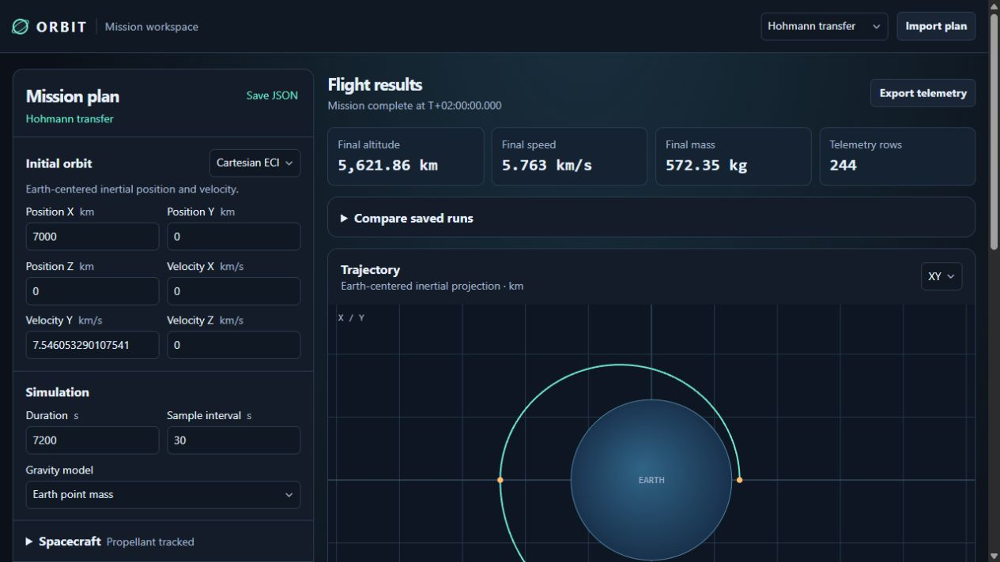
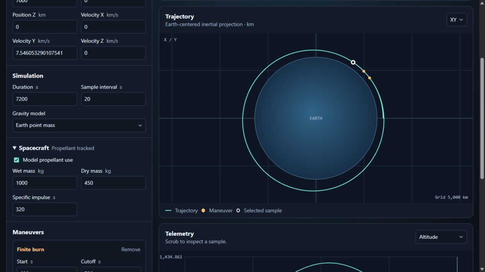
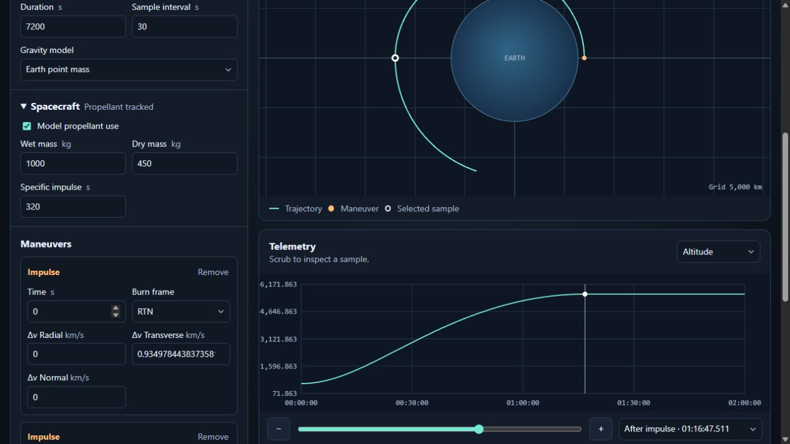
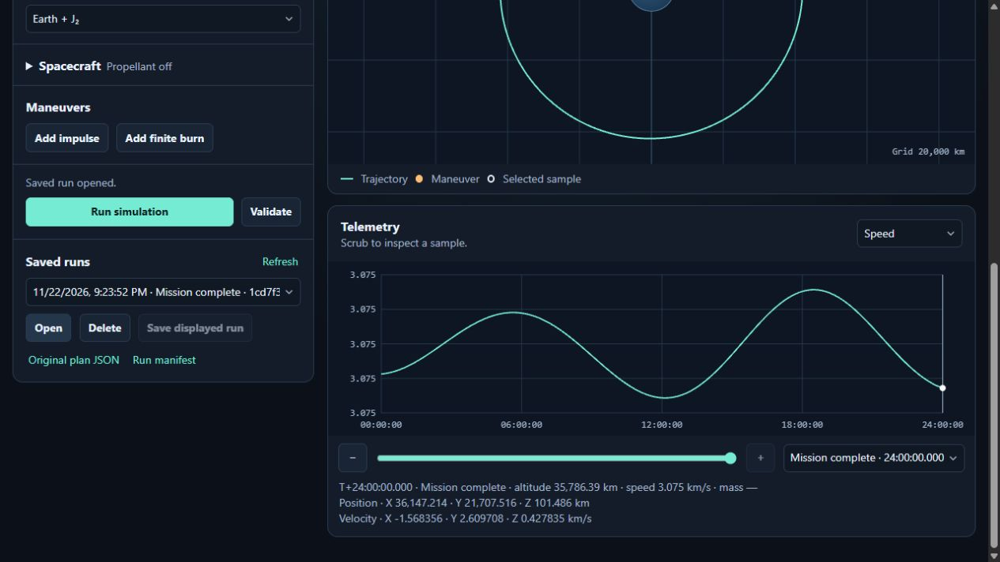
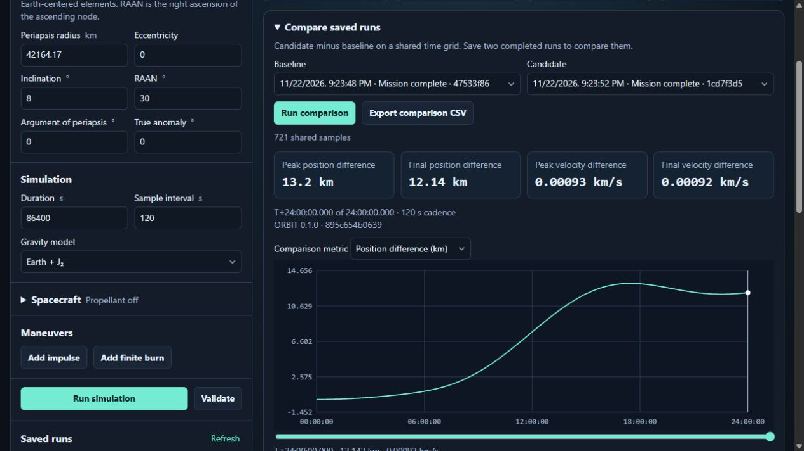
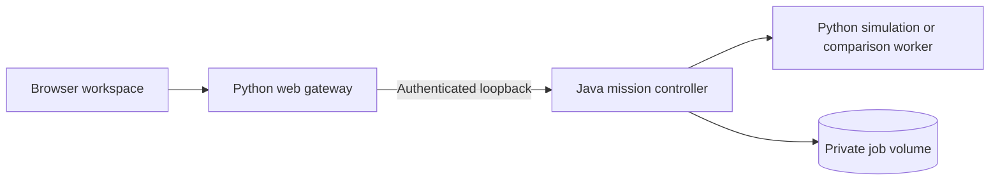

# ORBIT · Aerospace Mission Simulation Engine

ORBIT is an Earth-orbit simulator for mission planning and trajectory research.
Build a spacecraft mission, propagate it through scheduled maneuvers, and inspect
the resulting flight telemetry. Save runs to reproduce an experiment or compare
two trajectories on a shared time grid.



[Quick start](#quick-start) · [Browser workflows](#browser-workflows) · [Analysis tools](#analysis-tools) · [Architecture and deployment](#architecture-and-deployment) · [Technical reference](docs/reference.md)

## Quick start

Run commands from the repository root. The Python engine requires Python 3.11
or newer. The Java controller and optional viewer require JDK 17 or newer and
Maven. The Docker preview packages the web stack on a single host.

### Open a local browser preview

```sh
uv run --locked --extra web orbit-web
```

Open [the loopback workspace](http://127.0.0.1:8765/). The preview starts with
the Hohmann example. Try another example or import a version 1 mission JSON.

### Enable saved runs and browser comparisons

Use the queued workspace. The deployment guide includes a Docker Compose
quick start with a persistent volume. To run the Java controller and Python
workspace directly, follow the technical reference.
[Docker preview](deploy/README.md#run-a-loopback-preview) · [Local controller setup](docs/reference.md#run-the-browser-workspace-with-queued-missions)

### Run the Python CLI

```sh
uv run --locked python -c "from pathlib import Path; Path('output').mkdir(exist_ok=True)"
uv run --locked orbit-sim examples/hohmann.json output/hohmann.csv
```

The CLI publishes a new file after propagation succeeds. Use an output
directory on a filesystem that supports hard links and choose a new filename
for each export. [Java controller CLI](docs/reference.md#run-a-mission)

## Browser workflows

### Plan a mission

Edit a Cartesian ECI state or Keplerian orbit, choose the gravity model, and
set mission duration and sampling cadence. Configure propellant and schedule
impulses or finite burns in ECI or radial, transverse, and normal (RTN)
coordinates. **Validate** checks the plan and **Save JSON** exports it.
Imported plans retain advanced settings such as embedded third-body ephemerides.



### Inspect flight results

Inspect XY, XZ, or YZ projections and plot altitude, speed, mass, or semi-major
axis. Use the event menu to jump to a maneuver and step between the pre-burn
and post-burn samples at the same timestamp. **Export telemetry** downloads the
canonical CSV.



### Preserve a research run

In queued mode, **Save displayed run** keeps a completed result beyond the
temporary job lifetime. Reopen it to restore the original plan and telemetry.
Running the opened plan before editing it submits the original bytes. Export
the original plan and a manifest with plan and telemetry SHA-256 hashes,
the ORBIT source fingerprint, and the Python, NumPy, and SciPy versions.



### Reproduce the lunar comparison

1. Run and save **Lunar baseline** and **Lunar perturbation** from the example menu.
2. Open **Compare saved runs** and select the respective baseline and candidate IDs.
3. Run the comparison, inspect the curves, and export the comparison CSV.

The examples produce **721 shared samples** at a **120-second cadence**,
with **13.20 km peak** and **12.14 km final** position separation. The
comparison propagates both original plans with the current engine and reports
candidate minus baseline. Plans must share duration and epoch. Surface impact
can limit coverage. The CSV includes separation, signed ECI and reference RTN
components, the run IDs, and engine provenance.



## Analysis tools

The Python tools run independently of the browser and controller. Commands and
file formats are documented in the technical reference.

| Workflow | Entry point | Output |
| --- | --- | --- |
| Mission propagation | `orbit-sim` | Cartesian state, events, orbital elements, and mass telemetry |
| Ground tracks and station access | `python -m orbit_sim.groundtrack` | Ground-track CSV or GeoJSON and station visibility windows |
| Eclipse analysis | `python -m orbit_sim.eclipses` | Umbra, penumbra, and annular intervals or solar-visibility samples |
| Power and battery budget | `python -m orbit_sim.power_budget` | Solar input, state of charge, and energy accounting |
| Trajectory comparison | `python -m orbit_sim.compare` | Aligned position and velocity differences in ECI and reference RTN |
| Monte Carlo dispersion | `python -m orbit_sim.ensemble` | Seeded trial outcomes and final-state statistics |
| Linearized covariance | `python -m orbit_sim.covariance_timeline` | State covariance transported along the nominal trajectory |
| Ephemeris interchange | `python -m orbit_sim.horizons` and `python -m orbit_sim.oem` | Imported JPL vectors and CCSDS OEM export |

Example plans cover [Hohmann transfer](examples/hohmann.json),
[finite thrust](examples/finite_burn.json),
[J₂ nodal regression](examples/j2_precession.json),
[orbital decay](examples/orbital_decay.json),
[apsis detection](examples/apsides.json),
[lunar perturbation](examples/lunar_perturbation.json), and
[solar eclipses](examples/solar_eclipses.json).
[Mission plan schema](docs/reference.md#mission-plan) · [Python API](docs/reference.md#python-api) · [Optional JavaFX telemetry viewer](docs/reference.md#replay-telemetry-in-javafx)

## Architecture and deployment

The queued workspace runs the browser gateway and job controller as separate services.



- **Python engine** owns numerical models, plan validation, telemetry, and analysis. [Engine source](src/orbit_sim/)
- **Java controller** bounds the queue and worker runtime, publishes successful outputs, and verifies stored artifacts by digest. [Controller source](controller/)
- **Browser workspace** handles mission authoring, flight inspection, saved runs, and comparisons. [Workspace source](src/orbit_sim/web_assets/)
- **Docker deployment** provides a loopback Compose preview and an HTTPS target for an authenticated AWS Application Load Balancer. The hosted gateway verifies signed identity claims and scopes artifacts to the signed-in owner. [Deployment guide](deploy/README.md)

Web requests accept plans up to 256 KiB and results up to 4,000 rows.
Temporary terminal jobs expire after 30 minutes. Saved runs persist on the
controller volume until deleted, with up to eight per owner. The store supports
one controller per volume. Live AWS staging verification remains pending.

## Numerical model and verification

ORBIT integrates trajectories with adaptive DOP853 and evaluates telemetry
between accepted steps. Its force model includes Earth point-mass or J₂
gravity, optional exponential drag and interpolated third-body gravity, and
scheduled thrust. Surface contact uses a spherical Earth. Station access, solar
visibility, and battery models depend on their documented approximations.
[Model assumptions and telemetry](docs/reference.md#telemetry-and-model)

Numerical tests cover analytic orbit cases, thrust and propellant use, JPL
reference vectors, and independent geometry calculations. Integration tests
cover cancellation, restart recovery, user isolation, and the lunar comparison.
[Validation cases and profiling](docs/reference.md#verify-and-profile)

```sh
mvn -f controller/pom.xml verify
mvn -f viewer/pom.xml verify
uv run --locked --extra web --extra hosted python -m unittest discover -s tests -v
node --test tests/test_browser_workspace.mjs
```

The verification workflow also exercises the packaged workspace and its HTTPS
profile. [Continuous integration](.github/workflows/verify.yml)
