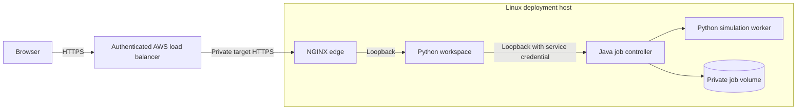

# Deploy the ORBIT web workspace

The deployment uses three containers on one Linux host. The edge proxy
shares its network namespace with the Python workspace and Java
controller, which listen on loopback. Only the edge port is published.
The controller mounts the job volume. Both application containers read
the service credential from a mounted file outside the build context.
The images use non-root processes and read-only root filesystems.
[Docker Compose networking](https://docs.docker.com/compose/how-tos/networking/)



## Run a loopback preview

From the repository root with Docker running in Linux-container mode,
create a temporary credential outside the checkout. This PowerShell
example keeps the token out of the command output.

```powershell
$orbitPrivateDir = Join-Path $env:LOCALAPPDATA ('ORBIT-preview-' + [guid]::NewGuid())
New-Item -ItemType Directory -Path $orbitPrivateDir | Out-Null
$env:ORBIT_JOB_TOKEN_PATH = Join-Path $orbitPrivateDir 'job-token'
[IO.File]::WriteAllText($env:ORBIT_JOB_TOKEN_PATH, [Convert]::ToHexString([Security.Cryptography.RandomNumberGenerator]::GetBytes(32)))
docker compose -p orbit-preview -f deploy/compose.yaml -f deploy/compose.preview.yaml up --build --wait
```

Open [the preview](http://127.0.0.1:8765/). Select **Run simulation** to
submit the Hohmann example. With Python 3.11 or newer on the host, the
smoke test runs a mission, restarts the controller, verifies that the
job ID and CSV survived, and cancels another mission.

```powershell
python tools/smoke_container.py --restart-controller orbit-preview
docker compose -p orbit-preview -f deploy/compose.yaml -f deploy/compose.preview.yaml down
```

Stopping the stack preserves its job volume. Keep the credential file
available while the project is running. On Linux, grant the application
container's UID 10001 read access to that file and restrict host access
to its parent directory.

## Run an HTTPS target behind AWS

Use the hosted overlay on the deployment host. Configure the AWS
listener for Cognito or OIDC before forwarding. The target group uses
HTTPS on port 8443 and `GET /healthz` for health checks. Permit inbound
target traffic only from the ALB security group. The workspace needs
outbound HTTPS to the regional ALB public-key endpoint.
[AWS ALB authentication requirements](https://docs.aws.amazon.com/elasticloadbalancing/latest/application/listener-authenticate-users.html)

Set the variables below in the deployment environment.

| Variable | Purpose |
| --- | --- |
| `ORBIT_PUBLIC_ORIGIN` | Canonical public HTTPS origin. |
| `ORBIT_ALB_ARN` | ARN of the load balancer that signs the identity. |
| `ORBIT_OIDC_ISSUER` | Exact identity issuer configured on the listener. |
| `ORBIT_OIDC_CLIENT_ID` | Expected identity client ID. |
| `ORBIT_TARGET_BIND_IP` | Private IPv4 address of the deployment host. |
| `ORBIT_JOB_TOKEN_PATH` | Private file containing the shared controller credential. |
| `ORBIT_TLS_CERT_PATH` | PEM certificate for the HTTPS target. |
| `ORBIT_TLS_KEY_PATH` | Private PEM key readable by the edge container's UID 101. |

```sh
docker compose -p orbit-hosted -f deploy/compose.yaml -f deploy/compose.hosted.yaml config --quiet
docker compose -p orbit-hosted -f deploy/compose.yaml -f deploy/compose.hosted.yaml up --build --wait
```

Use private host storage for the job volume and keep its backups under
the same access controls. Use one controller per volume. Completed
jobs are retained for 30 minutes, including across a controller
restart. When replacing the edge container or updating the image,
stop and recreate the whole Compose project with `down` followed by
`up`. That preserves the named volume and reconnects all three
containers to the new edge namespace.

The package expects the load balancer, certificates, identity
provider, and network controls to be configured on the deployment host
and in AWS.
